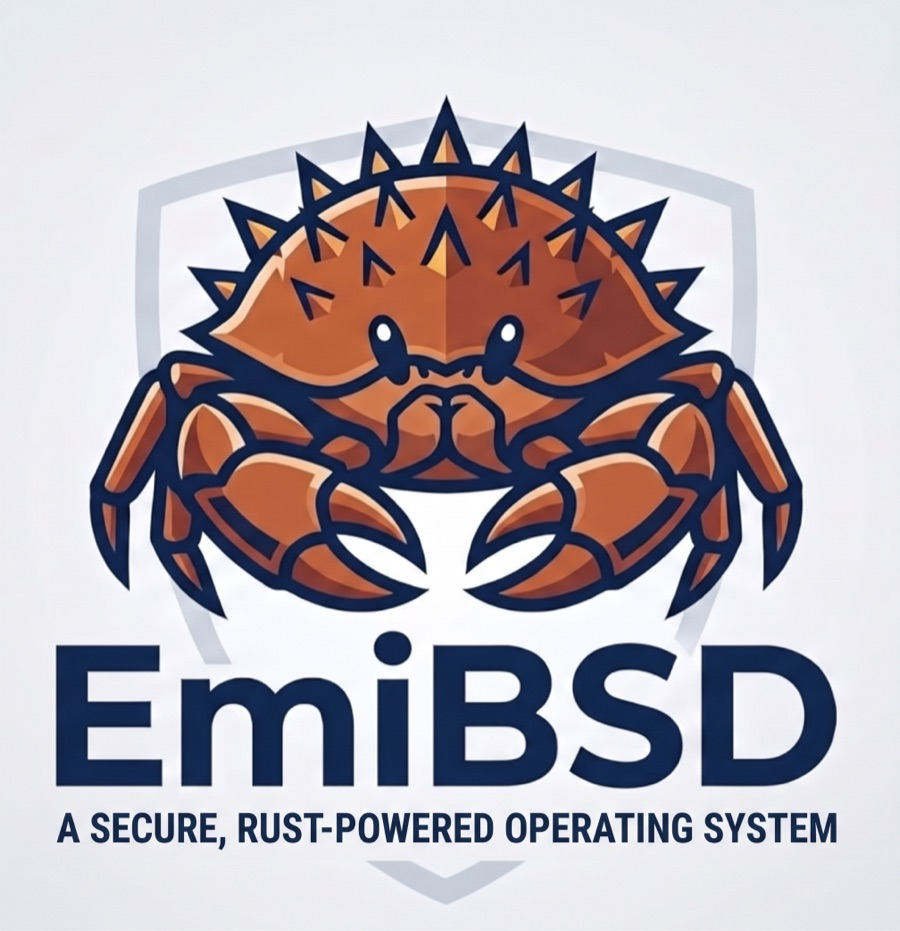
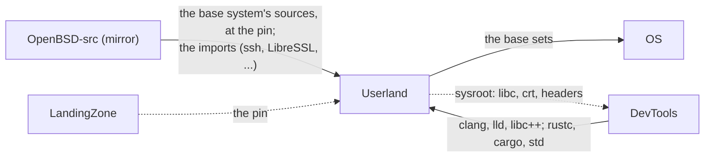

# EmiBSD Userland

<p align="center">
  
</p>

<p align="center"><em>Ferffy, the EmiBSD mascot: a <a href="https://en.wikipedia.org/wiki/Lithodes_santolla">centolla</a>, the child of Ferris (Rust's crab) and Puffy (OpenBSD's pufferfish).</em></p>

<p align="center"><strong>The base system above the kernel: one tree, every program placed by what it does.</strong></p>

<p align="center">
  <a href="LICENSE"></a>
  <a href="rust-toolchain.toml"></a>
  <a href="catastro.md"></a>
  <a href="https://www.emibsd.org"></a>
</p>

> **Not for production.** EmiBSD is an experiment. It runs only in QEMU, and its crypto,
> network and storage code is unaudited. Do not use it to protect real data or real networks.

The monorepo of EmiBSD's own userland: the programs, libraries and configuration that run
above the [Kernel](https://github.com/EmiBSD/Kernel). Phase 3 of the project: until the
kernel's redesign closes at N9, EmiBSD runs an inherited base system unmodified; this repository
is where the system that replaces it is written.

## Where it sits



The pin is LandingZone's, because it fixes the ABI the kernel implements; the toolchains come
from DevTools; OS assembles the sets with the kernel into a release. The whole picture is in
[Governance](https://github.com/EmiBSD/Governance) (`docs/architecture.md`).

## Rules (the user's decisions of 2026-10-23)

- **Two classes of program** (`docs/PROGRAM.md`). *Written*: from scratch, under a
  definition, in Rust; nothing is a port or a translation of another system's program: the
  as the reference for behaviour. *Imported*: cryptography, the security and network
  protocols with a living upstream and a CVE history, and the legacy giants (`ssh`, LibreSSL,
  `unbound`, `smtpd`, `vi`, `tmux`, `mandoc`, ncurses, the compilers, ...) are compiled from
  their upstream at the pin of their `UPSTREAM.toml`, never rewritten; our patches are a
  numbered series, ideally empty. `just status` counts both.
- **Rust** for what is written; C only where the ABI demands it, assembly only in libc's
  syscall stubs. `#![forbid(unsafe_code)]` in every program; `unsafe` only in `lib/libc`,
  `libexec/rtld` and `lib/crates/sys` (the thin FFI the programs share), each site with a
  written proof, as the kernel's `hal`.
- **One grammar for every program** (`docs/PROGRAM.md`, "The common grammar"; the user's
  decision of 2026-10-24, taken with `ls`): a program is a query over records with a schema;
  `-o name|table|wide|json|yaml|custom-columns=...` picks the renderer, `--sort-by=.field`
  the order, `--no-headers` the table's header; `--request` takes the whole invocation as
  one JSON document (a file, or inline) and `--show-request` prints it; under `-o json` the
  diagnostics are records too (`severity`, `code`, `subject`), one per line on standard
  error, so a person and a machine drive the same program the same way. POSIX's short flags
  keep their meaning, and
  to a pipe the output is POSIX's byte for byte; to a terminal the defaults are modern (ISO
  dates, human sizes, headers). BSD-only flags nobody remembers are not kept.
- **LLVM and Rust, nothing GPL.** `compiler/llvm` is LLVM as OpenBSD ships it, with its
  patches and build glue; `compiler/rust` is rust-lang/rust at the pinned stable tag, built
  against that LLVM, so the system builds itself (the `comp` set) and the `*-unknown-openbsd`
  targets, tier 3 in Rust, get their `std` from a stable release's source, not from nightly.
- **Upstreams are mirrored in the organisation** (`EmiBSD/OpenBSD-src`, `EmiBSD/rust`, ...),
  so an upstream that moves or disappears does not take the build with it. A tarball upstream
  gets a repository where each release is one commit. Fetched sources live under `upstream/`,
  gitignored and read-only; a build applies `patches/` to a copy under `target/`, never to
  `upstream/`. `tools/upstream.py` fetches, verifies (commit, SHA-256, signature) and pins.
- **`just`.** Every program carries a `justfile` that imports `tools/program.just`; the root
  `justfile` runs over all of them. `cargo` builds; `just` is the recipes. Not make: the build
  is Cargo's, and BSD make is itself one of the programs (imported).
- **Versions.** Semver per program (`src/Cargo.toml`, or `version` in `UPSTREAM.toml` with
  our patch level as `+emibsd.N`); a calendar version, `YEAR.MONTH`, for the system release.
  A commit that changes a program's code carries `Change: breaking|feature|fix` and the bump
  it calls for; the `commit-msg` hook (`just setup`) refuses it otherwise, and `just changelog`
  writes each program's `CHANGELOG.md` from the trailers (`docs/PROGRAM.md`, Versions).
- **Performance, concurrency and security are part of every definition**: a performance
  budget measured against a reference system's program on the same input (`bench/`, `just bench`); the
  concurrency model, and stress tests on four CPUs for what serves many; a threat model, the
  `pledge`/`unveil` profile, and the program's CVE history (`tests/cve/`), each entry made
  impossible by a type, a check or the language, or tested.

## Layout

The BSD split at the top: `bin/` and `sbin/` are what works with only the root
partition mounted (linked static), `usr/bin/` and `usr/sbin/` the rest; `bin` and `usr/bin`
are for the user, `sbin` and `usr/sbin` for operating the system. Inside each, the programs
are grouped by what they do. A concept the tradition spreads over two trees keeps a distinct
name in each (`bin/files` and `usr/bin/file-tools`, `sbin/network` and `usr/sbin/network/`),
and the README of each says where its other half is. Every program is listed once, in the
tree the tradition keeps it in; `tools/layout.py` regenerates the READMEs and the skeletons from
the map and refuses to write when one is missing or doubled.

```
bin/
├── shells               The shells.
├── files                The basic file operations.
├── processes            Listing, signalling and pacing processes; the shell's primitives.
├── system               The machine's name, the terminal line, a checksum.
└── tapes                Tape and changer control.
sbin/
├── boot                 Process 1, going down, the console and the terminals.
├── storage/disks        Partitions, labels, device nodes and controllers.
├── storage/filesystems  Making, checking and tuning file systems.
├── storage/mounts       Mounting, and serving file systems over NFS.
├── storage/swap-backup  Swap, dumps, restores and quotas.
├── network              Interfaces, routes, the packet filter, address configuration and name resolution.
├── ipsec                IPsec and its key daemons.
└── kernel               Reading and setting the kernel's state.
usr/bin/
├── text                 Filters and transformers of text streams.
├── records              Querying the records the written programs emit (`-o json`); EmiBSD's own, no counterpart elsewhere.
├── editors              Editors and the pager.
├── file-tools           Finding, describing and installing files (the basic operations are bin/files).
├── process-tools        Running things under a changed environment, priority or limit; the shell's helpers (the primitives are bin/processes).
├── users                Logging in, identities, who is on the machine, talking to them.
├── network-clients      Network clients a user runs.
├── development          Build tools, source generators, version control and tracing.
├── docs                 Manual pages and terminal descriptions.
├── calc                 Calculators and calendars.
├── mail                 Reading and sending mail from the command line.
├── scheduling           Running things later.
├── media                Audio, MIDI, radio and CD.
├── system-info          What machine this is, how it is doing, and small system chores.
├── crypto               Certificates, signatures and keys from the command line.
├── yp-clients           Querying the YP/NIS directory (its servers are usr/sbin/yp).
└── misc                 What fits nowhere else.
usr/sbin/
├── base-daemons         What rc starts on every system, and rc's control program.
├── accounts             Creating users and groups, the databases built from them, accounting, tokens (what a user does with their own identity is usr/bin/users).
├── storage-admin        Boot blocks, images, quotas, iSCSI, media (the root-partition tools are sbin/storage).
├── network/admin        Neighbours, traces, captures, link state (the root-partition tools are sbin/network).
├── network/dhcp         DHCP, DHCPv6 and router advertisements: the servers and the lease controls.
├── network/routing      Routing daemons and their control programs.
├── hardware             Buses, firmware, GPIO and the guest-host channel.
├── stats                Kernel and I/O statistics.
├── services             Servers: web, mail, time, DNS, LDAP, SNMP, domains.
├── yp                   The YP/NIS servers (the clients are usr/bin/yp-clients).
├── auth                 RADIUS, authpf, wireless authentication and certificate renewal.
├── vpn                  IKE control, PPP and L2TP (the IPsec daemons are sbin/ipsec).
├── nfs-rpc              The RPC services and network boot.
├── printing             Printing.
├── virtualization       vmm(4)'s daemon and control program.
├── packages             Packages, firmware, patches and upgrades.
├── kernel-dev           Configuring, tracing and packaging kernels (the running kernel's state is sbin/kernel).
└── wscons               Console screens, fonts and the console mouse.
libexec/
├── login                The authentication back ends login(1) calls.
├── rtld                 The run-time linker.
├── network-daemons      Daemons inetd and the RPC services start.
├── mail                 Local delivery and the spam daemon.
└── system               The login prompt, the nightly security check, the kernel relinker, the traditional cpp.
lib/
├── libc                 The C library, its start-up files, threads and libm.
├── crypto               Cryptography and authentication.
├── terminal             Terminal handling and line editing.
├── system               The rest.
└── crates               The Rust crates the written programs share, each born with its first user and laid out as a program (docs/PROGRAM.md): `cli`, the common grammar (one declaration per program with typed options, --help as text and as a record, usage and diagnostics, exit codes; records, -o, --sort-by, tables, JSON, YAML, columns); `sys`, the thin FFI over libc (passwd and group lookups, the terminal, local time, pledge, uid and umask, mkfifo and mknod, file flags, a link's times and mode), the one place beside lib/libc and libexec/rtld where `unsafe` is allowed, each site with its proof. EmiBSD's own; no counterpart elsewhere.
compiler/
├── llvm                 LLVM with OpenBSD's patches and build glue (gnu/llvm, gnu/usr.bin/clang), from the pinned tree.
└── rust                 rust-lang/rust at the pinned stable tag, built with x.py against compiler/llvm; its std for the `*-unknown-openbsd` targets (the Kernel's ABI) is how the tier 3 problem is solved without nightly.
etc/
├── rc                   The start-up scripts and the terminal table.
└── base                 Users, groups, shells, the protocol tables, device nodes, the file-system skeleton, root's dotfiles, the per-architecture files.
data/
├── zoneinfo             The IANA time zone database (tzdata; zic and zdump are usr/sbin/services).
├── locale               Locale definitions and character maps.
├── dict                 The word lists spell(1) and look(1) read.
├── termtypes            The terminal descriptions, source of terminfo (tic is usr/bin/docs).
└── misc                 Small tables of share/misc: ascii, airport codes, units, the magic of file(1) is in file itself.
distrib/
├── sets                 The install sets and their lists; the release version is YEAR.MONTH (docs/PROGRAM.md, Versions).
├── installer            The installer, its ramdisk and the per-architecture media.
├── include              The recipe that assembles /usr/include from what each library of lib/ exports; no header is kept here.
└── share                The recipe that assembles /usr/share: every program's man/ rendered, data/, share/mk; no file is kept here.
regress/
├── scenarios            One directory per scenario: the steps, the expected lines, the comparison with a reference system.
└── harness              Booting the images, driving the console, collecting and comparing.
```

The lists are the map to what a complete base system provides, taken from the names at the pin of
`Kernel/reference/PINNED.md`, not a porting list: the written programs are EmiBSD's own.

## Open

- **Perl.** `pkg_add`, `adduser`, `libtool`, `pkgconf` and `security` are traditionally Perl, and
  Perl (Artistic or GPL, dual) is not in the tree: import it under the Artistic licence, or
  write those five in Rust. The user's decision; their skeletons say so.
- `cargo audit` and `cargo deny` (`just audit`, part of `just check` when installed) are
  tools installed outside the repository with `cargo install`; `tools/cve.py` (`just cve
  <dir>`) queries NVD over the network. Both written, neither run: pending the user's OK.
- `data/` entries are imports like the programs (tzdata, the locales): their `UPSTREAM.toml`
  files are to be written.

New code is ISC (`LICENSE`).
