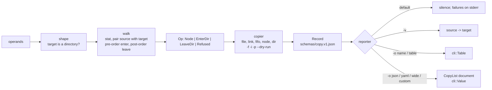

# cp: design

## Architecture

Modules, one each: `options` (the one declaration, `COMMAND`, and the `Config` whose enums
cannot contradict each other), `walk` (the shape of the command line, the sources into
operations, errors as refusals), `copy` (each operation performed, as a record), `report`
(what the user sees). `main` parses through `cli`, pledges what the configuration needs,
walks, copies, reports, exits.

What every careful `cp` knows and this one does too, in its own shape: the two shapes of the
command line and the `dir/..` edge; a new file's mode is the source's shaped by the umask
with the set-id bits dropped, kept only for the owner in the same group; an existing file
keeps its mode and owner; a directory is created owner-writable and given its real mode
after its contents; `-p` sets times, then owner (a refusal drops the set-id bits silently),
then mode, then flags; holes for zero blocks; FIFOs and nodes recreated under `-R`; links
followed everywhere without `-R` and nowhere with it unless `-H` or `-L`. What it does not
keep: `fts(3)`, the global `PATH_T` buffer, the `-r` option, the socket that warns but exits
0.

## Concurrency

Single-threaded, one 64 KB buffer, the path stack of `-R`. A copy is I/O bound; the kernel
overlaps what it can. Nothing to stress.

## Threat model

Hostile input is the file system: a source tree that changes while copied (a directory
replaced by a link between `stat` and `open`), link loops, names with control characters,
a target that is a link to somewhere else, set-id files owned by others. The attacker gains
a write where the user did not point (`cp -R` following a planted link; `-f` writing
through a link) or a privilege (set-id bits on a copy they own). Bounds: `-P` is the default
under `-R`; `-f` unlinks the target and creates anew, never writes through; set-id bits
survive only for the owner in the same group; cycles are detected by `(dev, ino)`; names are
never interpreted, only copied; `pledge` makes anything beyond the declared file operations
a kill. The time-of-check gap between `stat` and `open` is the kernel's to close
(`O_NOFOLLOW` is not used; recorded, not closed).

## Security

`pledge` with promises derived from the options, before the first operand is examined:
`stdio rpath wpath cpath fattr` always; `dpath` only with `-R` (`mkfifo`, `mknod`); `chown`
only with `-p`. This one never runs unpledged, whatever the options. No `unveil`: the operands are what the user
named. No privileges, not setuid.

## Data

`schemas/copy.v1.json`: the `CopyList` document and its items. Versioned in `apiVersion`; a
field is added without a version change, removed or retyped only with `v2`. `--help -o json`
follows `lib/crates/cli/schemas/command-help.v1.json`.

## Decisions

1. **An action is a stream of records.** `ls` made the record a query's result; `cp` makes
   it the trace of an action, one per source examined, with `action` saying what happened.
   `-v` and `-o` are two renderings of the same records, and `--dry-run` produces them
   without the side effect. Rejected: records only for successes (a failed copy is the one a
   tool most wants to see).
2. **`--dry-run` exists** because the record model makes it free: the walk and the pairing
   run, the copier reports `planned` and writes nothing. Not in POSIX; an EmiBSD addition.
3. **`-r` is refused**, not accepted and discouraged: it is `-R` with links and specials done
   wrong, and a script that uses it gets a usage error (`unknown option -- r`, exit 2) rather
   than a wrong copy; the manual's STANDARDS names the fix.
4. **A socket is a failure.** The tradition warns and exits 0; a copy that silently left something
   out is the kind of half-truth the record model exists to avoid. Documented as the one
   visible difference.
5. **Pledge follows the options.** Instead of one wide profile for every run, this one
   adds exactly `dpath` and `chown` when `-R` and `-p` ask for them. The first instance of a profile derived from what the
   program declared it would do; `cli` may grow a general form of it.
6. **A walker of its own, not `fts`**, as `ls` decided; `cp`'s pre- and post-order visits are
   `EnterDir` and `LeaveDir`. `cp` and `ls` now each carry a `Meta` and a `(dev, ino)` cycle
   check: the second user `lib/crates/walk` was waiting for, to be extracted when `find` or
   `du` comes (the rule of three).
7. **No dependency outside the repository.** `std` has `chown`, `set_times`, `set_permissions`
   and `symlink`; what it lacks (`mkfifo`, `mknod`, the flags, a link's own times and mode,
   `getuid`, `umask`) went into `sys`, with its `// SAFETY:` proofs, rather than into a
   `libc` crate.

## Dependencies

`cli` (the declaration, the record, the renderers, `os_error`) and `sys` (`getuid`, `umask`,
`mkfifo`, `mknod`, flags, a link's times and mode, `pledge`): both of this repository. `std`
only otherwise.
