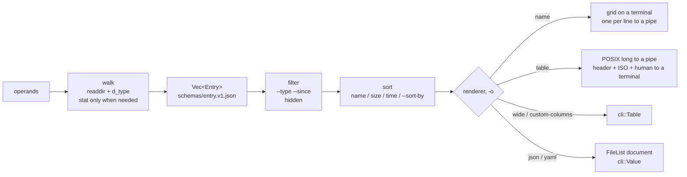

# ls: design

## Architecture

Modules, one each: `options` (the command line into a `Config` whose enums cannot
contradict each other), `walk` (operands and directories into listings; errors are entries),
`entry` (the record and its `Value`), `mode` (strmode, indicators, kinds), `time` (ISO,
POSIX, RFC 3339, pure over `sys::LocalTime`), `render` (the three shapes a listing takes
and the machine formats through `cli`). `main` pledges, parses, walks, renders, exits.

What OpenBSD's `ls` knows and this one keeps, without its shape: `stat` only when a flag,
a sort or a format needs it, and `d_type` otherwise; symbolic link operands followed unless
`-d`, `-F` or `-l`; non-directories listed before directories; `total` only for directories;
the six-month rule; `-l` beats `-g`. What it does not keep: `fts(3)`, the twenty global
flags, the two-pass width computation per printer, the five printers.

## Concurrency

Single-threaded, one listing in memory at a time. A directory of a hundred thousand entries
is one `Vec`, as in OpenBSD's `ls`; `-R` holds only the path stack. Nothing to stress.

## Threat model

Hostile input is the file system: names with control characters, escape sequences, invalid
UTF-8, 255 bytes; symbolic link loops; directories that change while listed; a passwd
database that lies. The attacker gains the terminal (an escape sequence drives it) or a
hang (a cycle). Bounds: `-q` is the terminal default and no control character reaches a
terminal; cycles are detected by `(dev, ino)`; a name is shown lossy, never interpreted;
`pledge` makes anything beyond reading and printing a kill.

## Security

`pledge("stdio rpath getpw")` before the first argument is read; a development host
without pledge runs the same call as a no-op. No `unveil`: `ls` lists what it is asked.
No privileges, not setuid. Never less than OpenBSD's ls(1) restricts: the same promises.

## Data

`schemas/entry.v1.json`: the `FileList` document and its items. Versioned in `apiVersion`;
a field is added without a version change, removed or retyped only with `v2`. `--help -o
json` follows `lib/crates/cli/schemas/command-help.v1.json`.

## Decisions

1. **`-o` is the output selector**, as in kubectl; OpenBSD's `-o` (file flags) becomes
   `--flags`. The one conscious break with POSIX XSI; it pays for the whole model. (The
   user, 2026-10-24.)
2. **POSIX to a pipe, modern to a terminal.** Scripts never see a terminal, so the long
   format to a pipe is byte for byte OpenBSD's, and a human gets ISO dates, human sizes and
   a header. Rejected: POSIX everywhere (the modern defaults would need a flag nobody types)
   and modern everywhere (breaks every `ls -l | awk`).
3. **The record first, the renderers after.** Five printers over a linked list became one
   `Entry`, one `Value`, and renderers that share `cli`. The cost: `-o json` builds every
   record; `name` to a pipe builds none and stays as cheap as before.
4. **A walker of its own, not `fts`.** `read_dir` and `d_type` give what `ls` needs with no
   `unsafe`; `fts`'s pre and post order, `FTS_NAMEONLY` and its error entries are three
   ideas, not a library. Moves to `lib/crates/walk` with its second user (`find`, `du`).
5. **No dependency outside the repository.** JSON and YAML are written by `cli::Value`
   itself; `serde` would be the first row of an allowlist that does not exist yet.
6. **Time formatting is pure.** `time.rs` formats a `LocalTime`; only `sys` touches `TZ`,
   so the program's tests never set environment variables (which is `unsafe` in Rust 2024).

## Dependencies

`cli` (the grammar, the record, the renderers) and `sys` (passwd and group names, the
terminal's width, local time, pledge): both of this repository. `std` only otherwise.
