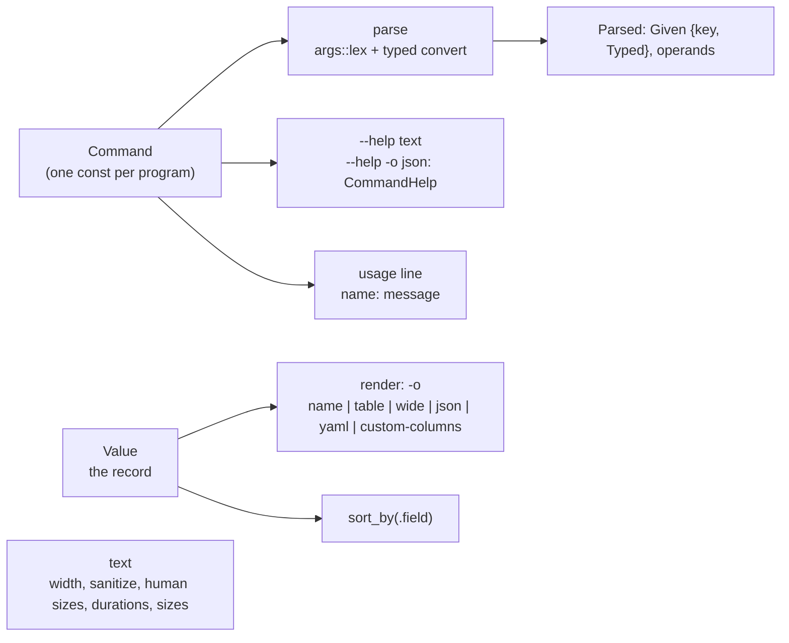

# cli: design

## Architecture

Modules, one each: `args` (the lexer: POSIX's rules plus long options; asks the command
what each name is), `command` (`Command`, `OptSpec`, `Kind`, `Typed`, `Parsed`, the help,
the usage, `exit`), `value` (`Value` and its writers), `render` (`Output`, `Table`, `grid`,
`render_records`), `text`.

## Concurrency

None. Pure functions and values; the writers take a `&mut dyn Write`.

## Threat model

Hostile input is the command line (a value of the wrong type, a path with a NUL) and the
records (names with control characters that reach a terminal). Bounds: every value is
checked against its declared kind before the program sees it; `sanitize` for terminals;
JSON and YAML writers escape every control character and quote what YAML would misread.

## Security

No `unsafe`, no I/O beyond the writers it is handed, no environment read.

## Data

`schemas/command-help.v1.json`: the `CommandHelp` record of `--help -o json`. Versioned in
`apiVersion`.

## Decisions

1. **One declaration, no derive.** `ls` 0.1 kept a `Spec` (what to parse) and a `Help` (what
   to document) that had to agree by hand; 0.2 folds them into `Command`, a `const` table a
   program writes once. A `#[derive(Command)]` would need a proc-macro crate for the same
   result; revisited when thirty programs repeat the table (the user's decision of
   2026-10-24).
2. **Types in the declaration, not in the program.** The parser converts and bounds
   `Int`, parses `Duration` and `Size`, restricts `Choice` and `List`, and words the error
   with the option's name; a program matches on `Typed` and never on a `String`. `-o`
   itself is a kind (`Format`).
3. **`--help` and exit code 2 are implied.** Every command has them; a program that declared
   them would declare them wrong eventually.
4. **The lexer is separate from the types** (`args::lex` takes a classifier closure), so the
   POSIX rules can be tested alone and another declaration style could drive them.
5. **The key is the long name.** A program matches `"output"` for both `-o` and `--output`
   and `"l"` for a short-only flag, so adding a long form to an option changes no match.
6. **No dependency.** JSON and YAML are written by hand (a few hundred lines); `serde` would
   be the first row of an allowlist that does not exist yet.

## Dependencies

`std` only.
