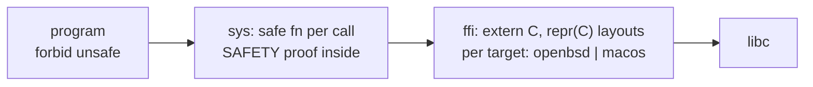

# sys: design

## Architecture

One file: the `ffi` module with the declarations and layouts, and one safe function per
call above it. Nothing else.

## Concurrency

The passwd and group caches are thread-local (`RefCell` in `thread_local!`), so no lock and
no sharing. `umask()` touches process-wide state for an instant (see DEFINITION).

## Threat model

Hostile input is libc's answer: a struct of the wrong layout would be read as garbage.
Bounds: the layouts are declared per target and any other target is refused at compile
time; buffers are owned by the caller for the duration of the call; strings are copied out
lossy, never kept as pointers.

## Security

`unsafe` only here (and `lib/libc`, `libexec/rtld`), each block with its proof; `pledge` is
offered, never relaxed.

## Data

None.

## Decisions

1. **Not the `libc` crate.** Twenty declarations, two targets: writing them keeps the
   dependency list empty and every layout in view. Revisited if the count passes a hundred.
2. **Only what `std` lacks.** `chown`, `set_times`, `set_permissions`, `symlink`, metadata are
   `std`'s and used directly by the programs; duplicating them here would spread `unsafe`.
3. **Per-target constants, one function.** `set_flags_nofollow` is `lchflags` on macOS and
   `chflagsat` on OpenBSD behind one signature; the programs never see the difference.

## Dependencies

`std` and libc (the system's).
