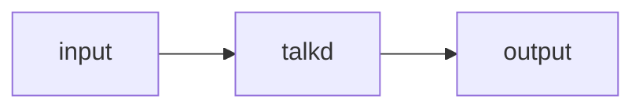

# talkd: design

## Architecture

## Security

`pledge(2)` promises, `unveil(2)` paths, privilege separation, setuid. Never less than
OpenBSD's talkd(8) restricts.

## Data

The schemas in `schemas/`; their versions; who consumes them.

## Decisions

Numbered, each with its reason and what was rejected.

## Dependencies

Crates used, each with why; the allowlist governs.
